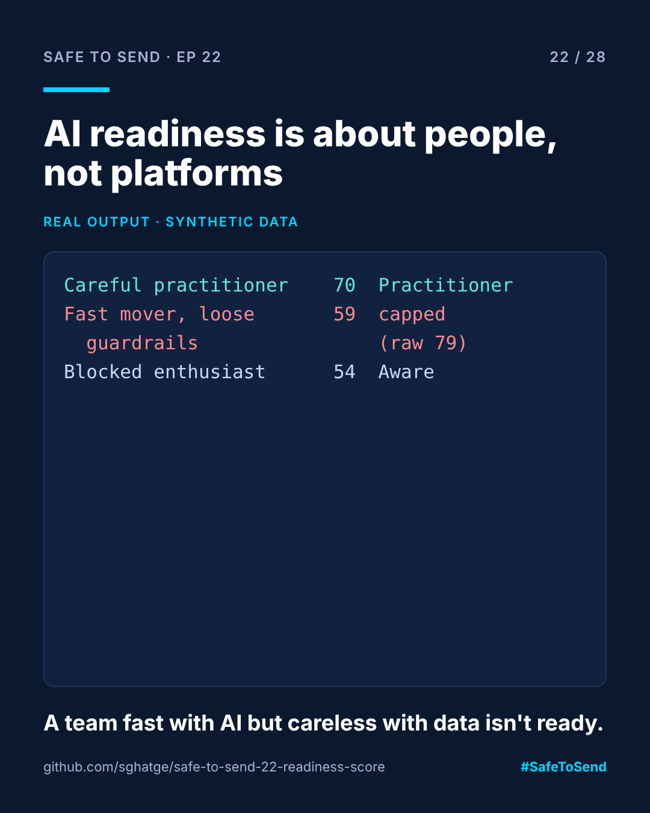

<div align="center">


**SAFE TO SEND · GOVERNED AI ENGINEERING SERIES · SAFE TO SEND 22 READINESS SCORE**

[GitHub Profile](https://github.com/sghatge) · [Portfolio](https://sghatge.github.io/adobe-campaign-v8-governance/)

</div>

---

# safe-to-send-22 · AI Readiness Score (CLI)



**Safe to Send · Episode 22** — a 28-day learn-in-public series on governing AI in CRM operations.

> Most AI-readiness tools score the platform. This one scores the people who have to use it.

## The real-world scenario

Leadership buys AI licences for the CRM team. Six months later, usage is low and nobody knows why. Is it skills? Access? Fear? Or is the one heavy user pasting customer exports into a public chatbot?

## The model

| Dimension | Framework | Weight |
|---|---|---|
| AI awareness | ADKAR Awareness | 8% |
| Attitude and willingness | ADKAR Desire | 10% |
| Practical AI skills | ADKAR Knowledge | 12% |
| Prompting and verification | ADKAR Ability | 12% |
| Role and use-case fit | Role fit | 10% |
| Data privacy and responsible AI | OECD · NIST AI RMF | **14%** |
| Access and organisational support | ADKAR Reinforcement | 10% |
| Confidence without over-reliance | OECD critical thinking | 8% |
| Applying AI to real work | ADKAR Ability | 10% |
| Continuous learning | ADKAR Reinforcement | 6% |

Answers are 1–5 (some reverse-scored). Levels: Beginner, Aware (40+), Practitioner (60+), Confident (75+), Champion (90+).

**Governance cap:** if the data-handling risk flag is raised, the score is capped at 59, the top of "AI Aware", however strong everything else is.

## Run it

```bash
python readiness.py examples/profiles.json
```

```
Careful practitioner            70/100  AI Practitioner
                               weakest: Access and organisational support (50), Attitude and willingness (62)
Fast mover, loose guardrails    59/100  AI Aware (raw 79, capped by data-handling flag)
                               weakest: Data privacy and responsible AI (25), Confidence without over-reliance (62)
Blocked enthusiast              54/100  AI Aware
                               weakest: Access and organisational support (12), Applying AI to real work (12)
```

The example's "fast mover, loose guardrails" profile has the highest raw score of the three (79), and is capped at 59 by the data-handling flag. That's the point of the cap.

## Web version

The interactive version, with team workshops and a what-if simulator, is the [AI Readiness Calculator](https://sghatge.github.io/ai-readiness-calculator/). This repo is the same scoring model as a small, testable library you can drop into your own tooling.

MIT · [Sangram Ghatge](https://www.linkedin.com/in/sangram-g-2369705b) · #SafeToSend
